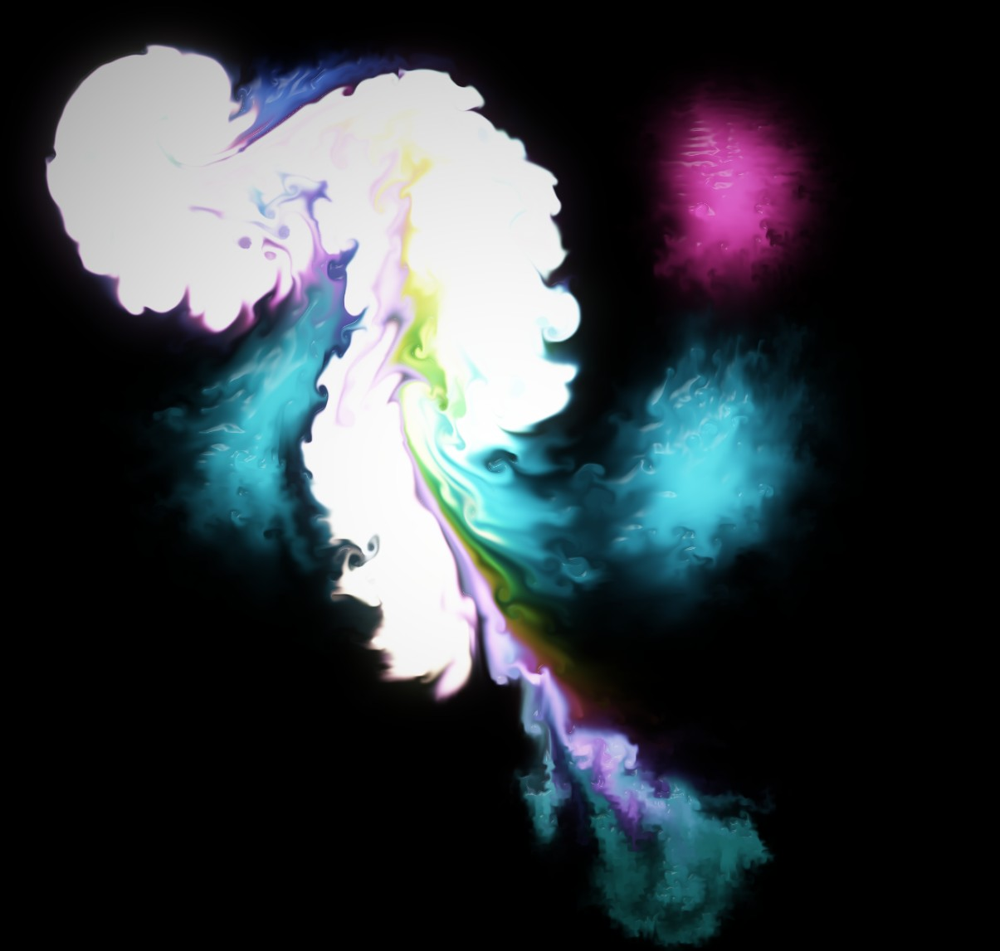
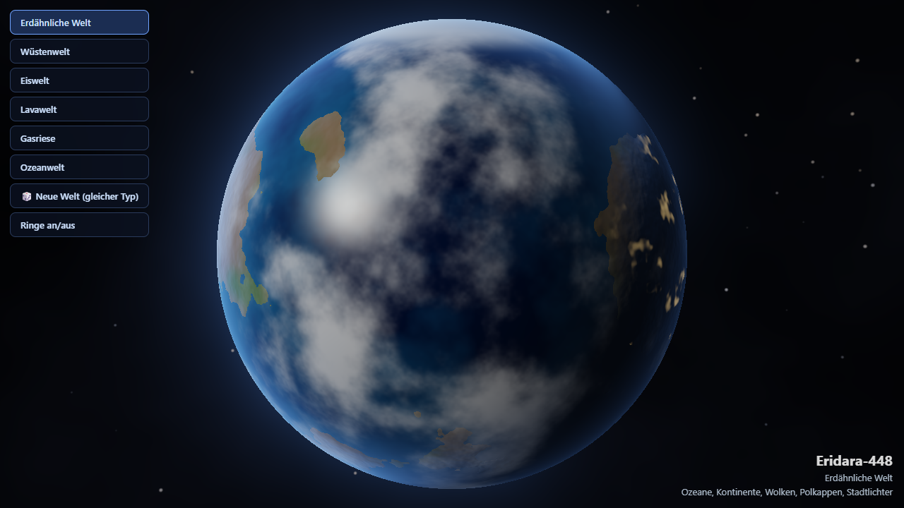
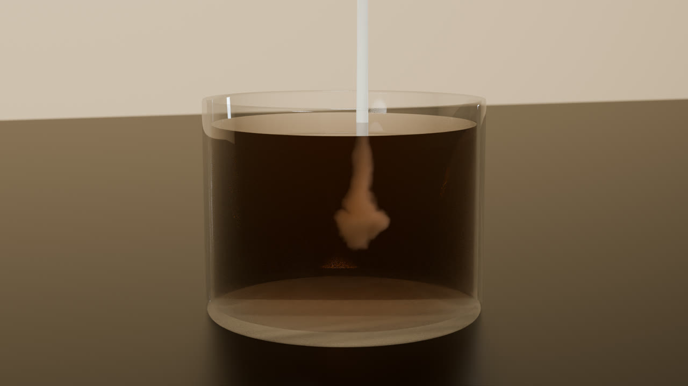
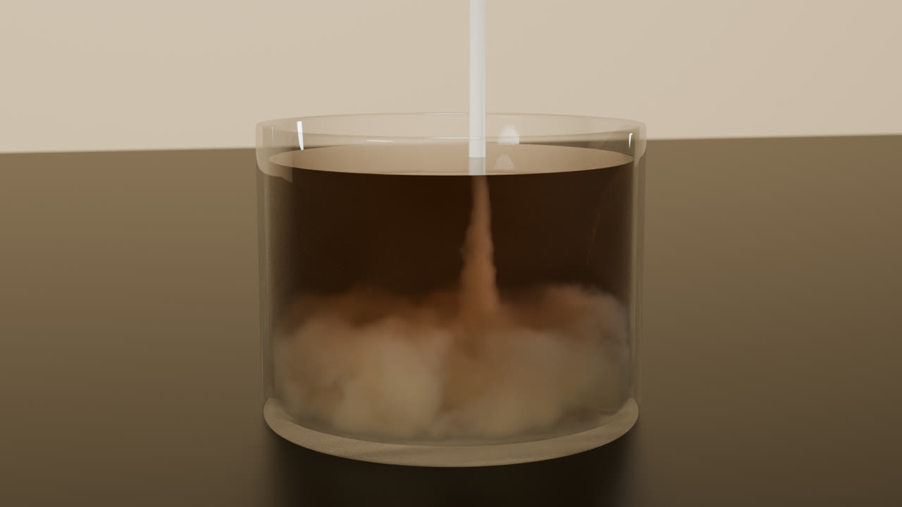
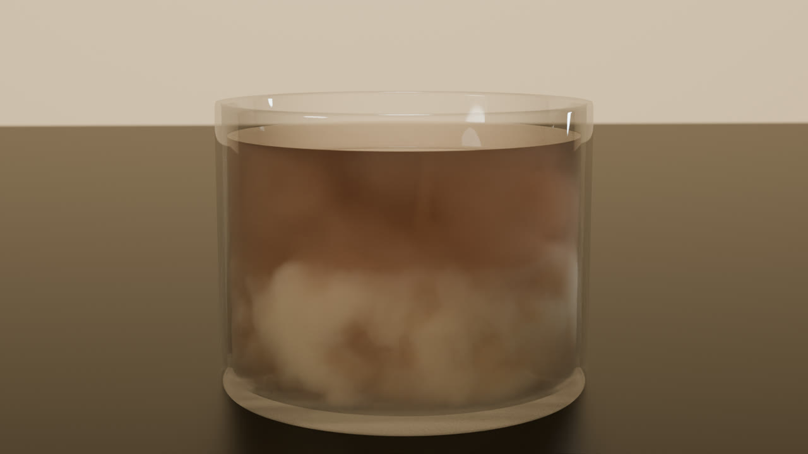
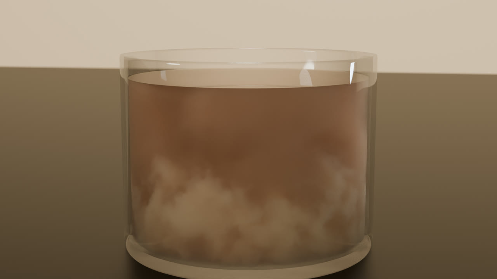
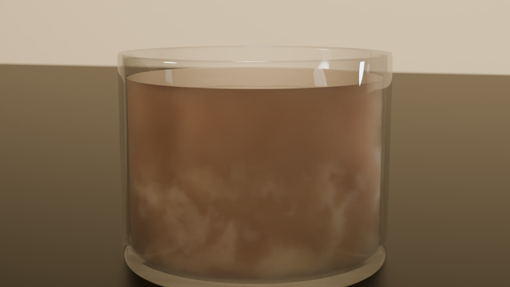

# Liquid

**Deutsch** · [English](#english)

Kleine Demos rund um Flüssigkeiten, Licht und Planeten – im Browser (WebGL2) und mit Blender (Cycles). Open Source unter MIT-Lizenz.

## Deutsch

### Inhalt

| Datei | Was es ist |
|---|---|
| `liquid-light.html` | 2D-Flüssigkeit auf der GPU (Navier-Stokes: Advektion, Wirbel, Druckprojektion) mit Bloom. Einfach im Browser öffnen. |
| `genesis.html` | Prozedural per Raymarching-Shader erzeugte Planeten (erdähnlich, Wüste, Eis, Lava, Gasriese, Ozean, optional Ringe). |
| `kaffee-sahne-3d.html` | Echtzeit-3D-Voxelversion von Sahne im Kaffee. **Verworfen:** zu langsam und optisch schwach, bleibt als Vergleich im Repo. |
| `kaffee-blender/build2.py` | Sahne in Kaffee als Film: gitterfreie, prozedurale Volumen-Shader in Blender Cycles statt Voxel-Simulation. |
| `kaffee-sahne-cinematic.mp4` | Das gerenderte Ergebnis: 8 Sekunden, 1920×1080, 24 fps, ohne Ton. |

### Bedienung

- **Liquid Light:** Maus/Touch verwirbelt Farbe, Klick löst eine Explosion aus, `Leertaste` Autopilot, `B` Bloom, `C` Reset, `H` Anzeige ein/aus.
- **Genesis:** Welttyp links wählen, ziehen zum Drehen, Mausrad zum Zoomen.

### Fotos

**Liquid Light**



**Genesis**



**Sahne in Kaffee (Blender Cycles)** – Standbilder aus dem Film bei ca. 1,0 s, 2,5 s, 4,2 s, 6,2 s und 7,9 s







### Kaffee-Film selbst rendern

Voraussetzung: Blender (getestet mit 5.2.2), NVIDIA-GPU mit OptiX, `ffmpeg`.

```bash
blender -b -P kaffee-blender/build2.py -- build
blender -b -P kaffee-blender/build2.py -- render
```

Umgebungsvariablen: `FRAMES`, `SAMPLES`, `RX`, `RY`, `FRAMELIST`, `OUT`. Danach die Einzelbilder mit `ffmpeg` zu einem Film zusammensetzen.

### Bekannte Schwächen

- `liquid-light.html`: Nach mehreren Explosionen übersteuert das Bild zu Weiß.
- Kaffee-Film: Hintergrund eher hell-beige, Glas leicht milchig, Ende gleichmäßig braun.
- `build.py` (Mantaflow-Variante) wurde verworfen und liegt nur zur Dokumentation bei. `debug*.py` sind Hilfsskripte.

### Lizenz

MIT – siehe [LICENSE](LICENSE).

---

## English

Small demos about liquids, light and planets – in the browser (WebGL2) and with Blender (Cycles). Open source under the MIT license.

### Contents

| File | What it is |
|---|---|
| `liquid-light.html` | 2D GPU fluid (Navier-Stokes: advection, vorticity, pressure projection) with bloom. Just open it in a browser. |
| `genesis.html` | Procedural planets rendered by a raymarching shader (Earth-like, desert, ice, lava, gas giant, ocean, optional rings). |
| `kaffee-sahne-3d.html` | Real-time 3D voxel version of cream in coffee. **Discarded:** too slow and visually weak; kept for comparison. |
| `kaffee-blender/build2.py` | Cream in coffee as a film: grid-free procedural volume shaders in Blender Cycles instead of a voxel simulation. |
| `kaffee-sahne-cinematic.mp4` | The rendered result: 8 seconds, 1920×1080, 24 fps, no sound. |

### Controls

- **Liquid Light:** mouse/touch stirs the colour, click triggers an explosion, `Space` autopilot, `B` bloom, `C` reset, `H` toggle HUD.
- **Genesis:** pick a world type on the left, drag to rotate, mouse wheel to zoom.

### Photos

See the images in the German section above: `docs/liquid.jpg`, `docs/genesis_earth.png` and the five film stills `docs/kaffee_*.jpg` (about 1.0 s, 2.5 s, 4.2 s, 6.2 s, 7.9 s).


### Render the coffee film yourself

Requirements: Blender (tested with 5.2.2), NVIDIA GPU with OptiX, `ffmpeg`.

```bash
blender -b -P kaffee-blender/build2.py -- build
blender -b -P kaffee-blender/build2.py -- render
```

Environment variables: `FRAMES`, `SAMPLES`, `RX`, `RY`, `FRAMELIST`, `OUT`. Then assemble the frames into a video with `ffmpeg`.

### Known weaknesses

- `liquid-light.html`: after several explosions the image blows out to white.
- Coffee film: fairly light beige background, slightly milky glass, uniformly brown ending.
- `build.py` (Mantaflow variant) was abandoned and is only kept for documentation. `debug*.py` are helper scripts.

### License

MIT – see [LICENSE](LICENSE).
